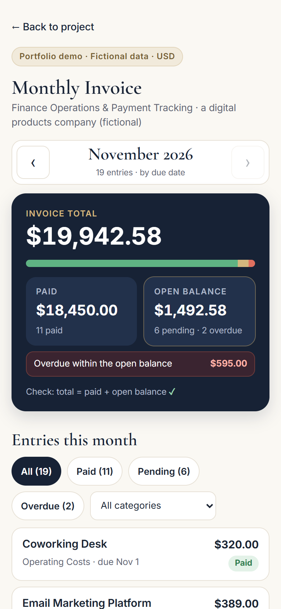
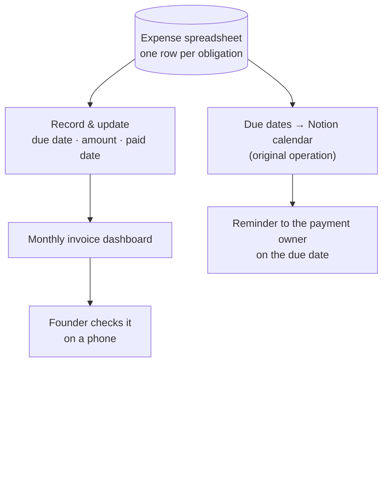
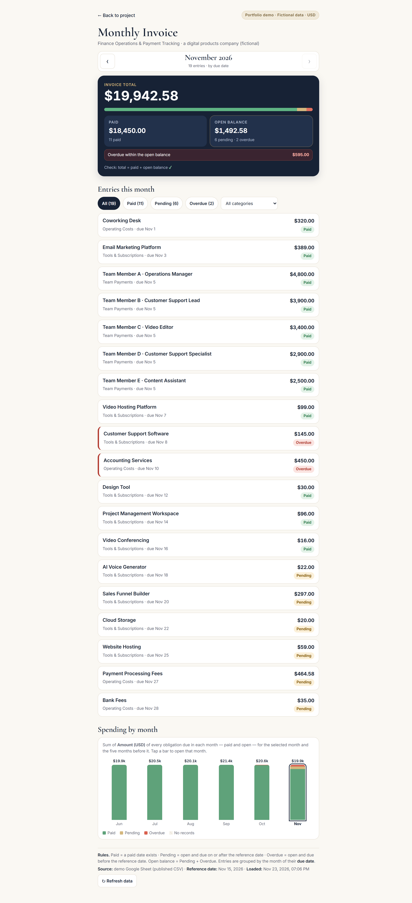
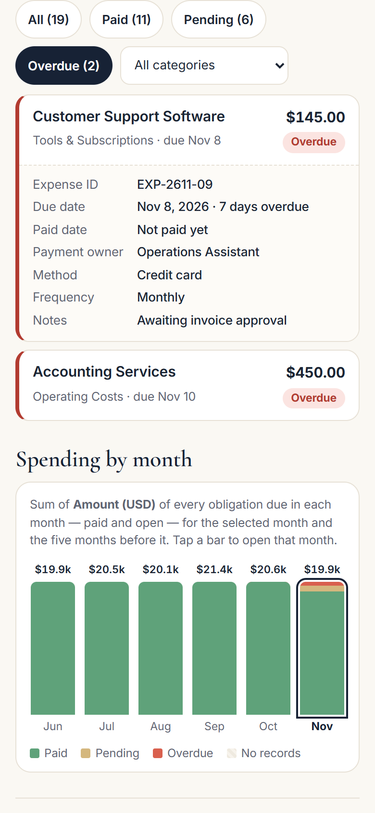

# Finance Operations & Payment Tracking

I managed and tracked the expenses and payments of a digital products company — tools and subscriptions, operating costs and team payments — and built a monthly invoice dashboard so the founder could see, from a phone, what was paid, what was still open and what was overdue. This public demo recreates the system with fictional data.

### **[→ Open the live invoice dashboard](https://naclisolucoes.com/portfolio-camila-nacli/finance-operations-payment-tracking/invoice-dashboard/)**

[View the demo spreadsheet (read-only)](https://docs.google.com/spreadsheets/d/e/2PACX-1vQ0i_42CR9aQeIjDKUPx7SZP8Fq-rjfeLs5BKqHsyvv2WnclcqzeB2fWPcH4sKxpStE-Qfqtwslq9f3/pubhtml) · [Download the demo spreadsheet (.xlsx)](https://raw.githubusercontent.com/CamilaNacli/finance-operations-payment-tracking/main/spreadsheet/finance-operations-demo.xlsx)

> **Professional Portfolio Demonstration** — This project is a portfolio demonstration based on a solution I developed and used in a real professional environment. All names, records, financial information, and other data presented are fictional and have been created exclusively for demonstration purposes. Original business information has been excluded to protect confidentiality. This demonstration showcases my practical experience, problem-solving skills, and ability to design and implement operational solutions using digital tools. *Amounts are shown in USD.*

---

## Overview

| | |
| --- | --- |
| **Context** | A digital products company with a remote team |
| **What was tracked** | Tools and subscriptions, operating costs and team payments |
| **Main output** | A monthly invoice-style dashboard the founder checked on a phone |
| **Supporting process** | A payment calendar in the company's Notion finance workspace, with a reminder on each due date (original operation — documented, not reproduced in the demo) |

## My role

- **Expense register:** I entered every expense in the spreadsheet — description, category, due date, amount and payment owner — and recorded the paid date when each one was settled.
- **Payment follow-up:** I kept the payment status up to date, so open and overdue items were visible every day.
- **Invoice dashboard:** I built a dashboard in the format of a monthly invoice. The founder opened it from the company workspace on a phone to see what was paid, what still had to be paid, which bills were overdue and the spending of the last six months.
- **Payment calendar:** I organized a calendar in the finance workspace in Notion. Due dates from the spreadsheet fed the calendar, and the process sent a reminder to the person responsible on the payment day.

## How it works

Two paths start from the same spreadsheet:

1. **Record and update → monthly invoice → founder on mobile.** Each obligation is one row. The dashboard groups entries by the month of the **due date** and shows the invoice total, what is paid and the open balance, with the overdue amount highlighted.
2. **Due dates → Notion calendar → reminder.** In the original operation, due dates from the spreadsheet appeared in a calendar in the Notion finance workspace, and the payment owner received a reminder on the due date. **This demo reproduces the invoice; the calendar is documented in [docs/payment-calendar.md](docs/payment-calendar.md).**

### Status rules (demo)

| Status | Rule |
| --- | --- |
| **Paid** | A paid date exists |
| **Pending** | No paid date, and the due date is on or after the reference date |
| **Overdue** | No paid date, and the due date is before the reference date |

- **Open balance** = Pending + Overdue, and **invoice total** = Paid + Open balance. Each obligation is either fully paid or fully open.
- The demo uses a fixed **reference date — Nov 15, 2026** — as “today”, so the statuses are always reproducible.

## Example walkthrough

Fictional entry **EXP-2611-10 · Accounting Services · Operating Costs · due Nov 10, 2026 · USD 450.00 · owner: Operations Assistant · no paid date.**

| Where | What you see |
| --- | --- |
| **Spreadsheet** | Status formula returns **Overdue** (due Nov 10, before the Nov 15 reference date) and *Days Overdue* = 5 |
| **Invoice — November 2026** | Total USD 19,942.58 = Paid USD 18,450.00 + Open balance USD 1,492.58. The open balance includes **USD 595.00 overdue** (this entry + Customer Support Software, USD 145.00), shown in red. Tapping the entry shows its ID, due date, “Not paid yet”, owner and method. |
| **Calendar (original operation)** | An event on Nov 10 — *Accounting Services · USD 450.00 · Operations Assistant* — and a reminder to the owner that morning. |
| **After payment** | When a paid date is entered, the status becomes **Paid** and the amount moves from the open balance to *Paid* in the invoice. |

## Dashboard features

- **Month selector** with previous / next buttons (and tappable bars in the chart).
- **Invoice summary:** invoice total, paid, open balance and the overdue amount inside the open balance, plus a check that total = paid + open.
- **Entries of the month:** description, category, due date, amount and status badge; filter by status (with counts) or category; tap an entry to see the details — no wide table on mobile.
- **Spending by month:** total of all obligations due in the selected month and the five months before it, split into paid, pending and overdue.
- **Source and reference date** shown on the page, with a *Refresh data* button.

## Demo spreadsheet

| Tab | Content |
| --- | --- |
| **About** | Notice, reference date and rules |
| **Settings** | Reference date used by the status formulas |
| **Expenses** | One row per obligation: Expense ID, Description, Category, Payment Owner, Payment Method, Frequency, Due Date, Amount (USD), Paid Date, **Status**, **Due Month**, **Days Overdue** (formulas in bold), Notes |
| **Monthly Summary** | Invoice total, paid, pending, overdue, open balance and a zero check for each due month |
| **By Category** | Spending by category and month |

The dashboard reads only the *Expenses* tab of the demo spreadsheet (published as CSV). A copy of the same data is in [`data/expenses.csv`](data/expenses.csv).

## Data confidentiality

- Every name, vendor, amount, date and owner in this repository is **fictional**. Team members appear as *Team Member A–E* with fictional monthly amounts between USD 2,500 and 5,000; tools and services use generic names.
- No original spreadsheet, dashboard, link, screenshot or calendar from the real operation is published. The demo is not connected to any production system.
- The company is described only as “a digital products company”.

More details: [docs/demo-environment.md](docs/demo-environment.md).

## Tools

Google Sheets / Excel formulas · Notion (calendar, original operation) · HTML, CSS and JavaScript · WordPress · GitHub.
