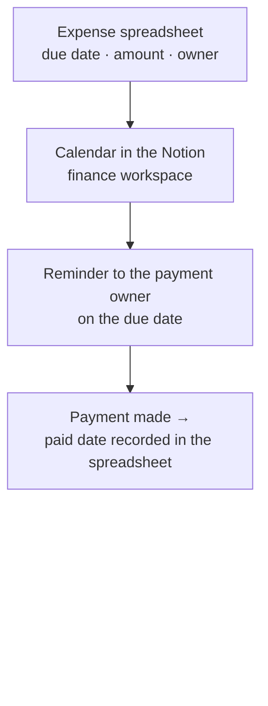

# Payment calendar (original operation)

[← Back to README](../README.md)

> This page documents how the payment calendar worked in the original operation. **It is not part of the interactive demo**, which reproduces only the monthly invoice. The example below uses fictional data.

## Purpose

The invoice dashboard answers *“what is paid and what is still open this month?”*. The calendar answers *“what has to be paid today, and who is responsible?”*. Together they kept payments from being forgotten.

## Flow

1. Each obligation in the spreadsheet has a due date, an amount and a payment owner.
2. An automation connected the spreadsheet to a calendar in the company's Notion finance workspace, so each due date appeared as a calendar entry. *(The integration tool is not specified in this public version.)*
3. On the due date, the process sent a reminder to the person responsible for the payment.
4. After paying, the paid date was recorded in the spreadsheet — the invoice dashboard then showed the item as **Paid**.

## Example (fictional)

| Field | Value |
| --- | --- |
| Expense | EXP-2611-10 · Accounting Services |
| Category | Operating Costs |
| Due date | Nov 10, 2026 |
| Amount | USD 450.00 |
| Payment owner | Operations Assistant |

**Calendar entry:** *Nov 10 — Accounting Services · USD 450.00 · Operations Assistant.*
**Reminder:** sent to the Operations Assistant on the morning of Nov 10.
**In the demo invoice:** with the reference date Nov 15, 2026 and no paid date, the entry appears as **Overdue** in November and is part of the USD 595.00 overdue amount.
